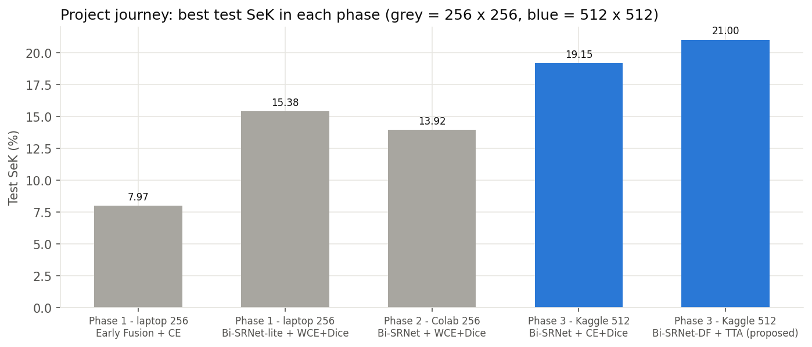
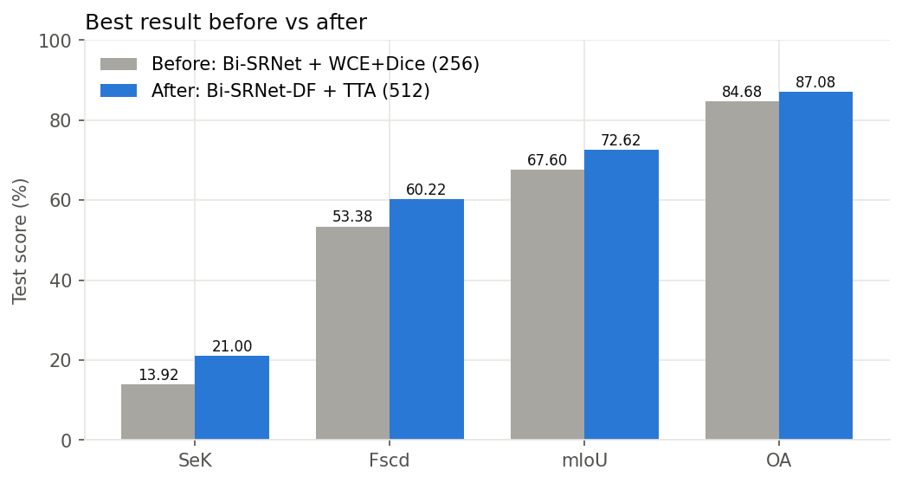
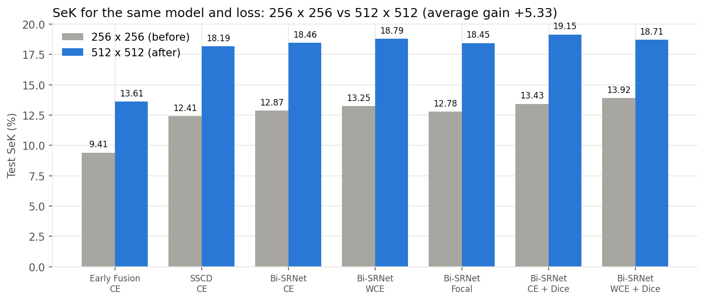
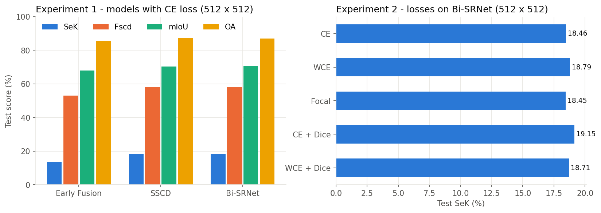
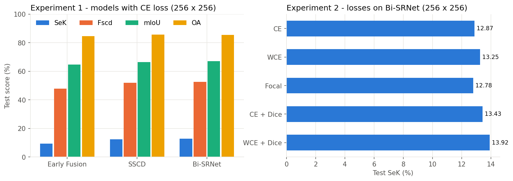
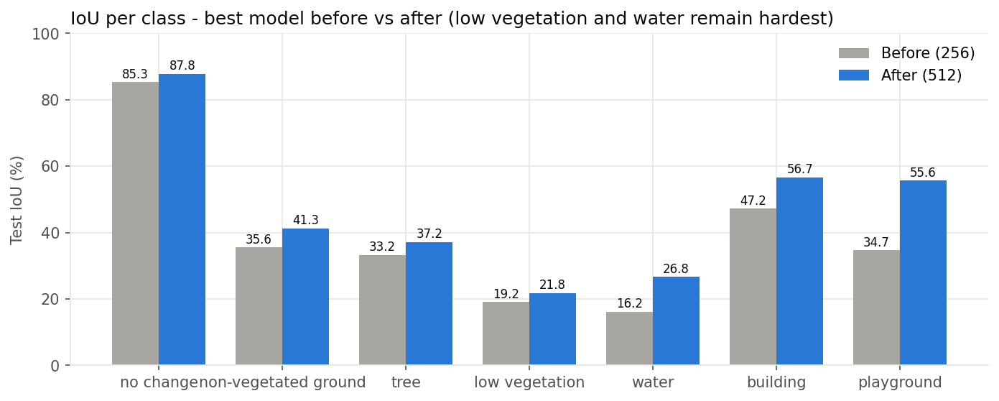
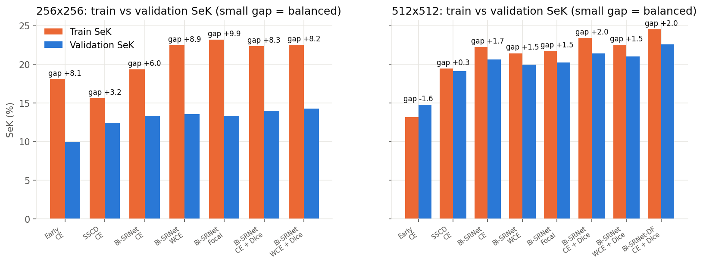
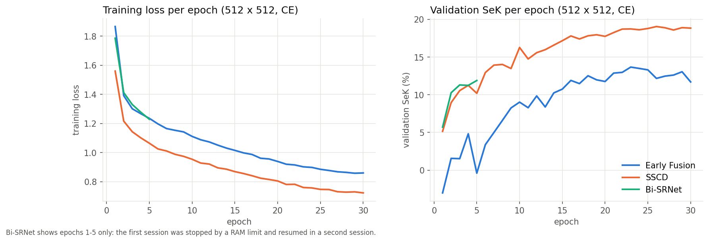
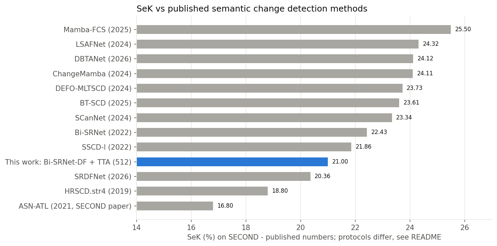

# Semantic Change Detection on SECOND: from 256×256 to 512×512

Semantic change detection (SCD) on the **SECOND** aerial dataset. Given two images of the same place taken at different times, the model predicts **where** the land changed and **what it changed from and to**, across 6 land-cover classes.

The work was done in **three phases**:

| Phase | Where | Setup | Best test SeK |
|---|---|---|---|
| [**1. Laptop, 256×256**](phase1_laptop_256/) | Apple M4 laptop (MPS) | ResNet-18, 3 architectures + 9 class-imbalance techniques + 3-fold cross-validation | 15.38 (Bi-SRNet-lite + WCE+Dice) |
| [**2. Colab, 256×256**](phase2_colab_256/) | Google Colab GPU | ResNet-18, 3 architectures + 5 losses | 13.92 (Bi-SRNet + WCE+Dice) |
| [**3. Kaggle, 512×512**](phase3_kaggle_512/) | Kaggle T4 GPU | **ResNet-34 at native resolution, faithful Bi-SRNet, new proposed Bi-SRNet-DF, TTA** | **21.00** (Bi-SRNet-DF + TTA) |



Phases 1 and 2 are independent code bases with slightly different random splits, so compare them only loosely. **Phases 2 and 3 use the identical split**, so the 256→512 comparison below is exact. Phase 3 against Phase 2:

| | Before (256×256) | After (512×512) | Change |
|---|---|---|---|
| Best model | Bi-SRNet + WCE+Dice | **Bi-SRNet-DF (proposed) + TTA** | |
| **SeK** (main metric) | 13.92 | **21.00** | **+7.08 (+51%)** |
| Fscd | 53.38 | 60.22 | +6.84 |
| mIoU | 67.60 | 72.62 | +5.02 |
| OA | 84.68 | 87.08 | +2.40 |

All numbers are on the held-out **test set**, with the **same split** in both studies.



---

## Contents

- [Dataset](#dataset)
- [Repository layout](#repository-layout)
- [What was done: version history](#what-was-done-version-history)
- [Models](#models)
- [Loss functions](#loss-functions)
- [Evaluation metrics](#evaluation-metrics)
- [Results](#results)
- [Overfitting / underfitting check](#overfitting--underfitting-check)
- [Comparison with published papers](#comparison-with-published-papers)
- [How to run](#how-to-run)
- [Limitations and next steps](#limitations-and-next-steps)
- [References](#references)

---

## Dataset

**SECOND** (SEmantic Change detectiON Dataset), Yang et al., IEEE TGRS 2021.

- 2,968 publicly labelled bi-temporal image pairs, 512×512 pixels, aerial RGB, 0.5–3 m resolution.
- Each pair has two label maps (T1 and T2). Pixels are either **no change** or one of 6 land-cover classes: non-vegetated ground, tree, low vegetation, water, building, playground.
- Only about 20% of pixels are changed, and water, low vegetation and playground are rare. This class imbalance is the main difficulty.

**Split used in both studies:** a random 70 / 10 / 20 split with seed 0, giving **2,077 train / 297 validation / 594 test** pairs. Model and loss selection used the validation set only. The test set was used once, for final reporting.

The notebook downloads the dataset automatically from Google Drive. On Kaggle, you can instead add any SECOND dataset that has `im1/ im2/ label1/ label2/` folders as an Input.

---

## Repository layout

```
Second/
├── README.md                     # this file: the whole story
├── requirements.txt
├── figures/                      # all comparison graphs (tools/make_figures.py)
├── tools/make_figures.py
├── docs/
│   ├── SECOND_SCD_Summary_256_vs_512.xlsx   # 12-sheet explained summary (meeting version)
│   └── literature/                          # research papers reviewed
├── phase1_laptop_256/            # Phase 1: laptop study (own README, scripts, results, logs, docs)
│   ├── README.md · scd.py · train.py · prepare_data.py · run_all.sh · run_cv.sh
│   ├── make_docs.py · make_excel.py · make_report.py · analyze_imbalance.py
│   ├── results/  (per-run JSON, summary.csv, cross-validation, Excel)
│   ├── logs/     (final training logs)
│   └── docs/     (methodology, results, diagnostics, references, roadmap, figures)
├── phase2_colab_256/             # Phase 2: Colab 256x256 study
│   ├── notebook/SECOND_SCD_256.ipynb · src/second_scd_256.py
│   └── results/  (Excel + CSV)
└── phase3_kaggle_512/            # Phase 3: Kaggle 512x512 study
    ├── notebooks/SECOND_SCD_512.ipynb        # final version (v4)
    ├── notebooks/drafts/                     # v2, v3 kept for history
    ├── src/second_scd_512.py · tools/build_512_notebook.py
    ├── results/  (Excel + CSV, incl. 256-vs-512 and vs-papers tables)
    └── logs/     (raw Kaggle logs used to diagnose crashes)
```

Model weights, datasets and virtual environments are not stored in git (see `.gitignore`). The scripts and notebooks recreate them.

---

## What was done: version history

### Phase 1: laptop study, 256×256 (`phase1_laptop_256/`)

- Platform: Apple M4 laptop, 16 GB, PyTorch MPS. SECOND was streamed from Google Drive into a 256 px copy.
- Controlled protocol: the same ResNet-18 backbone, decoder, split, seed and 20-epoch schedule for every run.
- Phase A compared Early Fusion, SSCD and Bi-SRNet-lite (SeK 7.97 → 13.59 → 14.24). Phase B tested 9 class-imbalance techniques on Bi-SRNet-lite. The best, **WCE + Dice, reached 15.38**. A 3-fold cross-validation confirmed the ranking.
- Full write-up: [`phase1_laptop_256/README.md`](phase1_laptop_256/README.md) and its `docs/` folder.

### Phase 2: Colab study, 256×256 (`phase2_colab_256/`)

- Platform: Google Colab. All images were down-sampled from 512 to **256×256** because of GPU memory, and the whole dataset was kept on the GPU.
- Backbone: **ResNet-18** (ImageNet). Decoder: small FPN with 64 channels. 20 epochs.
- Three models were compared with CE loss (Early Fusion, SSCD, a simplified Bi-SRNet). Then five losses were compared on the best model.
- Best result: **Bi-SRNet + WCE + Dice → SeK 13.92**.

### Phase 3: Kaggle study, 512×512 (`phase3_kaggle_512/`)

| Version | What changed | Outcome on Kaggle |
|---|---|---|
| v1 | First 512 notebook. It built a 6 GB memory-mapped cache of the whole dataset. | Kernel died. Not kept, because v2 replaced it. |
| v2 (`drafts/`) | Images read lazily from disk, so no big cache is needed. RAM and disk use are printed. | Download and data loading worked. The kernel crashed at the first training step. See `phase3_kaggle_512/logs/kaggle_v2_kernel_crash_log.txt`. |
| v3 (`drafts/`) | Single GPU instead of 2-GPU `DataParallel`, no `channels_last`, `faulthandler` turned on, class-weight divide-by-zero fixed. | Trained for 1.9 h (Early Fusion and SSCD finished), then was killed by a slow RAM leak. See `phase3_kaggle_512/logs/kaggle_v3_training_session_log.txt`. |
| **v4 (final)** | Fixed the RAM leak: references to finished batches are dropped, glibc malloc arenas are limited with `malloc_trim` each epoch, and RAM is logged every epoch. Training resumes automatically from the last epoch. | **All 8 runs completed.** |

### What changed from Phase 2 (256) to Phase 3 (512), and why it helps

| Aspect | Phase 2 (256×256) | Phase 3 (512×512) | Why it is better |
|---|---|---|---|
| Input | 256×256, down-sampled | **512×512 native** | Small objects and edges are not blurred away |
| Backbone | ResNet-18 | **ResNet-34** | Richer features. Same backbone as Bi-SRNet, SCanNet and LSAFNet |
| Bi-SRNet | One cross-attention at the deepest layer | **Self-attention + cross-attention Semantic Reasoning blocks at 1/16 and 1/32 scale**, plus consistency loss | Follows the original paper |
| Decoder | FPN, 64 channels | Panoptic-style FPN, 128 channels, all levels fused | Combines fine detail with global context |
| New model | none | **Bi-SRNet-DF** (see below) | Explicit "what changed" signal |
| Augmentation | flip, rot90 | + **T1↔T2 swap, random scale crop 1–1.5×, brightness/contrast jitter** | Regularisation, so less overfitting |
| Schedule | cosine, 20 epochs | warm-up + per-iteration cosine, gradient clipping, 30 epochs (50 for the proposed model) | More stable training |
| Inference | single pass, threshold 0.5 | **4-flip TTA** + change threshold tuned on validation | Removes random errors (+0.62 SeK) |
| Data | whole dataset on GPU | disk + background prefetch | 512 data does not fit on the GPU |

---

## Models

Every model outputs one binary change map and one 6-class semantic map for each date. All use ResNet-34 (ImageNet), AdamW (lr 3e-4, weight decay 1e-4), batch 8 and mixed precision.

| Model | Idea | Params |
|---|---|---|
| **Early Fusion** | T1 and T2 are stacked into a 6-channel input and passed through one encoder and one decoder | 23.0 M |
| **SSCD** | Siamese encoder with shared weights. A semantic decoder runs per date, and a change decoder uses the concatenated T1+T2 features | 24.3 M |
| **Bi-SRNet** | SSCD + Semantic Reasoning blocks: self-attention within each date and cross-attention between dates, plus a semantic consistency loss | 25.9 M |
| **Bi-SRNet-DF (proposed)** | Bi-SRNet + **(a)** differential features `[T1, T2, \|T1−T2\|]` at every scale, **(b)** Squeeze-and-Excitation channel attention, and **(c)** the change head also receives the semantic-difference prior `\|sem(T1) − sem(T2)\|` | 27.0 M |

---

## Loss functions

Every loss adds binary cross-entropy for the change map. Bi-SRNet and Bi-SRNet-DF also add a semantic consistency term: T1 and T2 class probabilities should be similar where nothing changed and different where something changed.

| Loss | What it does | SeK @256 | SeK @512 |
|---|---|---|---|
| CE | Standard per-pixel cross-entropy | 12.87 | 18.46 |
| WCE | Class weights = 1/√frequency, so rare classes count more | 13.25 | 18.79 |
| Focal | Down-weights easy pixels: (1−p)² · CE | 12.78 | 18.45 |
| CE + Dice | Adds Dice loss, which directly optimises region overlap | 13.43 | **19.15** |
| WCE + Dice | Combines both | **13.92** | 18.71 |

At 512, rare classes are already visible in the image, so class weighting helps less. **Dice** is the consistent winner at both resolutions.

---

## Evaluation metrics

| Metric | Meaning |
|---|---|
| **SeK (Separated Kappa)**, the main metric | Kappa over changed pixels only (true no-change removed) × e^(IoU_change − 1). It rewards correct from–to classes and is the official SECOND ranking metric |
| **Fscd** | F1 of changed pixels whose semantic class is also correct |
| **mIoU** | Mean of IoU(change) and IoU(no-change) |
| **OA** | Overall pixel accuracy. It is dominated by no-change pixels, so it is less informative |
| Precision / Recall / F1 | Binary change vs no-change |
| Per-class IoU | Overlap for no change + each of the 6 classes |
| Confusion matrix | TP / FP / FN / TN of changed pixels, plus TPR, FPR, FNR, TNR |

---

## Results

### 256 vs 512: same model and same loss

Every one of the 7 configurations improved, with an **average gain of +5.33 SeK**.



### Experiments at 512×512 (test set)

| Model | Loss | SeK | Fscd | mIoU | OA |
|---|---|---|---|---|---|
| Early Fusion | CE | 13.61 | 53.15 | 67.95 | 85.72 |
| SSCD | CE | 18.19 | 58.05 | 70.28 | 87.24 |
| Bi-SRNet | CE | 18.46 | 58.28 | 70.74 | 87.13 |
| Bi-SRNet | WCE | 18.79 | 57.89 | 71.33 | 87.17 |
| Bi-SRNet | Focal | 18.45 | 58.19 | 70.73 | 87.26 |
| Bi-SRNet | CE + Dice | 19.15 | 58.76 | 71.37 | 86.79 |
| Bi-SRNet | WCE + Dice | 18.71 | 58.16 | 71.05 | 86.79 |
| **Bi-SRNet-DF (proposed)** | CE + Dice | 20.38 | 59.62 | 72.25 | 86.81 |
| **Bi-SRNet-DF (proposed) + TTA** | CE + Dice | **21.00** | **60.22** | **72.62** | 87.08 |




**Where the gain comes from (SeK):**

| Step | Gain |
|---|---|
| 512 resolution + ResNet-34 + better training | about +5.5 |
| Best loss (CE + Dice) vs CE | +0.69 |
| Proposed Bi-SRNet-DF vs Bi-SRNet (same loss) | **+1.23** |
| Flip TTA | +0.62 |

### Confusion matrix and per-class results

| Best model | Recall (TPR) | Precision | Specificity (TNR) | FPR |
|---|---|---|---|---|
| Before (256) | 65.4% | 67.8% | 92.5% | 7.5% |
| After (512) | **72.4%** | **73.5%** | **93.7%** | **6.3%** |

The final model misses fewer real changes and raises fewer false alarms. Building (56.7 IoU) and playground (55.6) are detected best. **Low vegetation (21.8) and water (26.8)** remain hardest because they have very few training pixels.



Full tables (TP/FP/FN/TN per run, per-class precision and recall) are in `phase2_colab_256/results/`, `phase3_kaggle_512/results/` and in `docs/SECOND_SCD_Summary_256_vs_512.xlsx`.

---

## Overfitting / underfitting check

| | Train − validation SeK gap | Verdict |
|---|---|---|
| 256×256 | 3.2 – 9.9 points | Mild overfitting |
| 512×512 | −1.6 – 2.0 points | **Balanced (good fit)** |

The larger input and stronger augmentation act as regularisation. Validation SeK falls by less than 1 point after the best epoch, so training is stable, and the best checkpoint is kept automatically. Early Fusion has train SeK *below* validation SeK. That means it is capacity-limited (slight underfitting), which is consistent with it being the weakest model.




---

## Comparison with published papers



| Method | Year | SeK | mIoU | Fscd | OA |
|---|---|---|---|---|---|
| ASN-ATL (SECOND paper) | 2021 | 16.80 | 70.00 | – | – |
| HRSCD.str4 | 2019 | 18.80 | 71.15 | 58.21 | 86.62 |
| SRDFNet | 2026 | 20.36 | 70.31 | 60.25 | 87.64 |
| **This work: Bi-SRNet-DF + TTA** | 2026 | **21.00** | **72.62** | 60.22 | 87.08 |
| SSCD-l | 2022 | 21.86 | 72.60 | 61.22 | 87.19 |
| Bi-SRNet | 2022 | 22.43 | 73.38 | 61.62 | 87.48 |
| SCanNet | 2024 | 23.34 | 73.20 | 62.59 | 87.46 |
| BT-SCD | 2025 | 23.61 | 73.45 | 63.80 | 88.10 |
| ChangeMamba | 2024 | 24.11 | 73.68 | 64.03 | 88.12 |
| DBTANet | 2026 | 24.12 | 73.74 | 64.08 | 88.23 |
| LSAFNet | 2024 | 24.32 | 74.01 | 63.20 | 87.66 |
| Mamba-FCS | 2025 | 25.50 | 74.07 | 65.78 | 88.62 |

**What this shows:**
- This work beats ASN-ATL, HRSCD.str4 and the 2026 **SRDFNet** on SeK and mIoU, and matches SSCD-l on mIoU.
- It is 4.5 SeK below the best method found, Mamba-FCS. That gap comes mostly from the encoder. Mamba-FCS's own ablation shows its VMamba-Base backbone alone (ChangeMamba) reaches 24.11, and its extra modules add about 1.4.

**This comparison is indicative, not apples-to-apples.** Published methods train on all 2,968 public pairs, and several test on the official 1,694-pair test set. This work trains on 70% of the public pairs (2,077) and tests on its own 20%. The protocol matters: the same Bi-SRNet is reported as 22.43, 23.22 and 23.59 in different papers.

---

## How to run

**Kaggle (recommended, free T4 GPU)**

1. Create a notebook, then use **File → Import Notebook** to load `phase3_kaggle_512/notebooks/SECOND_SCD_512.ipynb`.
2. In Settings, choose **Accelerator: GPU T4** and set **Internet: On**.
3. Optionally, add a SECOND dataset through **Add Input**. Without one, the notebook downloads SECOND itself.
4. Set `QUICK_TEST = True` and use **Run All** for a 15-minute pipeline check.
5. Set `QUICK_TEST = False`, then **Save Version → Save & Run All**.
6. If the 12-hour session ends before training finishes: add this notebook's output as an Input and run again. Finished runs are loaded, and an interrupted run resumes from its last epoch.

Full training takes about 10 hours on one T4, split over two sessions.

**Colab:** the same notebook works. Results are saved to `MyDrive/SECOND_SCD_512`.

**Phase 1 (laptop):** see [`phase1_laptop_256/README.md`](phase1_laptop_256/README.md). Run `prepare_data.py`, then `run_all.sh` and `run_cv.sh`, from inside that folder.

**Phase 2 (Colab):** open `phase2_colab_256/notebook/SECOND_SCD_256.ipynb` in Colab with a GPU runtime and run all cells.

**Regenerate the figures and the notebook** (from the repository root)

```bash
pip install -r requirements.txt
python tools/make_figures.py        # rebuilds figures/ from the phase results
python phase3_kaggle_512/tools/build_512_notebook.py  # rebuilds the phase-3 notebook
```

---

## Limitations and next steps

- **Protocol:** retrain on all public pairs and evaluate on the standard test set, so the comparison with papers is exact.
- **Encoder:** ResNet-34 is the main gap to the top methods. Next is a stronger encoder such as VMamba-Base (as in Mamba-FCS), ConvNeXt or PVT-v2.
- **Losses and guidance:** add SeK and mIoU losses and change-guided attention (as in Mamba-FCS). Keep this work's semantic-difference prior, Dice loss and consistency loss, which together give *bidirectional* change↔semantic guidance.
- **Inference:** EMA or checkpoint averaging, and multi-scale TTA.
- **Rare classes:** class-aware sampling for water and low vegetation.

---

## References

- Yang K. et al., *Asymmetric Siamese Networks for Semantic Change Detection in Aerial Images* (SECOND dataset), IEEE TGRS, 2021. Dataset page: https://captain-whu.github.io/SCD/
- Ding L. et al., *Bi-temporal Semantic Reasoning for the Semantic Change Detection in HR Remote Sensing Images* (Bi-SRNet, SSCD-l), IEEE TGRS, 2022.
- Daudt R. C. et al., *Multitask learning for large-scale semantic change detection* (HRSCD), CVIU, 2019.
- Ding L. et al., *Joint Spatio-Temporal Modeling for Semantic Change Detection* (SCanNet), IEEE TGRS, 2024. arXiv:2212.05245
- *A Late-Stage Bitemporal Feature Fusion Network for Semantic Change Detection* (LSAFNet), arXiv:2406.10678
- Chen H. et al., *ChangeMamba*, IEEE TGRS, 2024. https://github.com/ChenHongruixuan/ChangeMamba
- *Mamba-FCS: Joint Spatio-Frequency Feature Fusion, Change-Guided Attention, and SeK Loss*, arXiv:2508.08232. https://github.com/Buddhi19/Mamba-FCS
- *A Dual-Branch Framework for Semantic Change Detection with Boundary and Temporal Awareness* (DBTANet), arXiv:2602.11466
- *SRDFNet: Semantic Refinement and Differential Features for High-Resolution Change Detection*, Sensors 26(11):3427, 2026.

The SECOND dataset belongs to its authors. Follow its terms of use; this repository does not redistribute the images.
